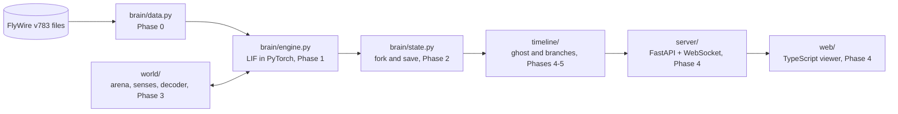

# Architecture

Phase 0: the shape the code will grow into. Each box is filled in by the phase named beside it.

*Diagram: the data files feed the loader, the loader feeds the engine, the engine exchanges senses and movement with the world, timelines fork the engine's state, and the server streams timelines to the web viewer.*

The brain and the world are separate packages, so the brain never knows what body it drives ([ADR-0006](../decisions/0006-2d-arena-no-physics-body.md)). Forks share weights and copy state ([ADR-0008](../decisions/0008-fork-shares-weights.md)).
