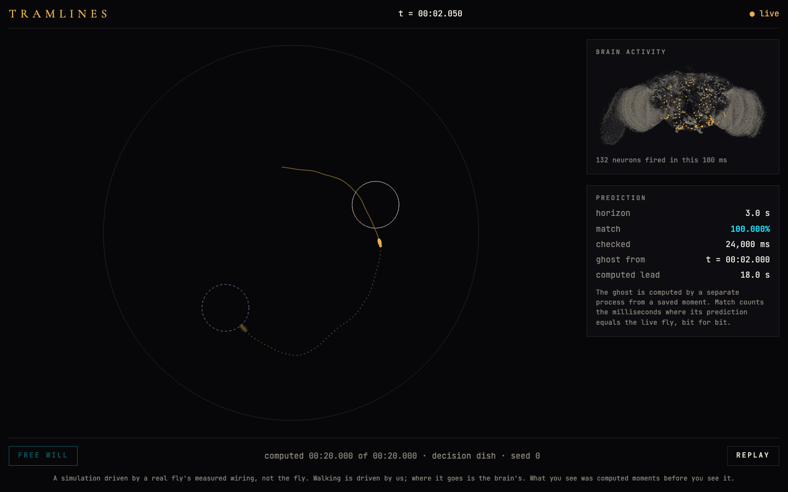

# Chapter 22 — The ghost

> What would it feel like to watch your own future walk a few steps ahead of you, and then follow it exactly?

## Where we are
You can fork a fly, brain, body and world together, and prove the copies stay identical. This chapter sends one copy ahead in time and lets it tell you, a second in advance, where the fly will be.

## The idea
A **ghost** is a [fork](glossary.md) that runs ahead. You copy the fly now, run the copy for one simulated second, and write down where it went. That record is a prophecy. Then you let the real fly live the same second. Because the two started from the same state, with the same random numbers waiting for them, the fly must walk the prophecy step for step.

Think of a train on rails. If you know where the rails go and how fast the train is moving, you can send a drone ahead along the track and photograph where the train will be in a minute. The train cannot be anywhere else. Here the "rails" are the [state](glossary.md) of 138,639 neurons, and the drone is a second copy of the brain.

The viewer does exactly this, with one difference that matters for honesty. Its ghost is not a fork in the same program: it runs in a **separate process**, loads the fly from a file saved a moment earlier, and predicts on its own. When its path matches the live fly to the bit, that is two independent computations agreeing ([ADR-0033](../decisions/0033-phase-4-architecture.md)).

## Build it
Save as `ch22/ghost.py`:

```python
"""Chapter 22: send a copy of the fly one second ahead, then watch the fly catch up."""

from tramlines.brain.connectome import load_connectome
from tramlines.brain.engine import enable_determinism
from tramlines.brain.neurons import load_catalog
from tramlines.timeline.timeline import Timeline
from tramlines.world.arena import DECISION_ARENA
from tramlines.world.decoder import FlyDecoder
from tramlines.world.fly import DEFAULT_START
from tramlines.world.senses import FlySenses

enable_determinism()
catalog = load_catalog()
fly = Timeline(
    load_connectome(),
    DECISION_ARENA,
    FlySenses.from_catalog(catalog),
    FlyDecoder.from_catalog(catalog),
    seed=0,
    start=DEFAULT_START,
)
fly.run(500)  # half a second of life

ghost = fly.fork()
prophecy = ghost.run(1000)  # the ghost lives the next second first

print(f"now: t = {fly.fly.time_ms} ms, fly at ({fly.fly.x_mm:.2f}, {fly.fly.y_mm:.2f}) mm")
end = prophecy[-1]
print(f"the ghost says: at t = {end.time_ms} ms it will be at ({end.x_mm:.2f}, {end.y_mm:.2f}) mm")

reality = fly.run(1000)  # now the fly lives that second itself
end = reality[-1]
print(f"the fly:        at t = {end.time_ms} ms it is at   ({end.x_mm:.2f}, {end.y_mm:.2f}) mm")

matched = sum(p == q for p, q in zip(prophecy, reality, strict=True))
print(f"milliseconds predicted: {len(prophecy)}, matched exactly: {matched}")
print("brains identical at the end:", fly.fingerprint() == ghost.fingerprint())
```

## Run it

```bash
uv run python ch22/ghost.py
```

```text
now: t = 500 ms, fly at (5.02, 6.00) mm
the ghost says: at t = 1500 ms it will be at (19.03, 6.00) mm
the fly:        at t = 1500 ms it is at   (19.03, 6.00) mm
milliseconds predicted: 1000, matched exactly: 1000
brains identical at the end: True
```

Then see it on the machine's screen: build the viewer once (`cd web && npm install && npm run build`), start the server (`uv run python -m tramlines.server`) and open `http://127.0.0.1:8000`. The faint gold fly ahead of the live one is the ghost; the cyan **match** reads 100.000%.



## The click
The prophecy was written before the fly moved, and the fly walked it to the millisecond. Not approximately: every position, every heading, every feeding decision, a thousand times in a row, equal down to the last bit.

This is the machine at the heart of the project, and it is worth sitting with how ordinary its parts are. A copy of some numbers. A loop. A comparison. Nothing in it is magic, and nothing in it is a claim about real flies or real minds ([honesty](../honesty.md)). It is what *any* deterministic system allows, made visible. The strangeness you may feel watching the ghost lead and the fly follow is the point of the whole project: the feeling of a future that is already written.

## Break it

1. Before `fly.run(1000)`, call `fly.brain.inject_spike(...)` on an input neuron (`fly.brain.input_neurons[0]`). Does the prophecy still hold? (Chapter 23 is about exactly this.)
2. Make the ghost look further: `ghost.run(3000)` and `fly.run(3000)`. Does the match ever slip?
3. Fork the ghost *after* changing `fly.fly.heading_rad` by a millionth of a radian. What happens to the match?
4. Run the viewer and watch "checked" climb while "match" never moves.

## When it goes wrong

- **The match is below 100%.** Something mutable is shared between the copies, or something was edited after forking. Run `uv run pytest tests/test_determinism.py` and read what fails.
- **The viewer says "computing ahead" for a long time.** The first run computes the whole projection (minutes). Later runs replay instantly from `data/projections/`.
- **`ModuleNotFoundError: fastapi`.** Run `uv sync` in the project.

## Check yourself

1. What is the ghost, in one sentence?
2. Why must the ghost and the fly start with the same random generator state?
3. Why does the viewer's ghost run in a separate process?
4. Does a 100% match prove the future of a real fly is fixed?

??? note "Answers"
    1. A fork of the fly that runs ahead in time, so its path is a prediction of the fly's.
    2. The fly's senses draw random numbers every step; with a different position in the sequence it would receive different input and its future would differ.
    3. So the match compares two separate computations that share nothing but a saved moment. Drawing one timeline twice would match by construction and prove nothing.
    4. No. It shows this simulation is deterministic, which we built it to be. It says nothing about real flies or free will.

## Decisions in this chapter

- [ADR-0030: projection, not live](../decisions/0030-projection-not-live.md)
- [ADR-0033: the projector, the independent ghost and the viewer](../decisions/0033-phase-4-architecture.md)

## Next
The ghost is always right; in Chapter 23 you will add one spike and break it.
