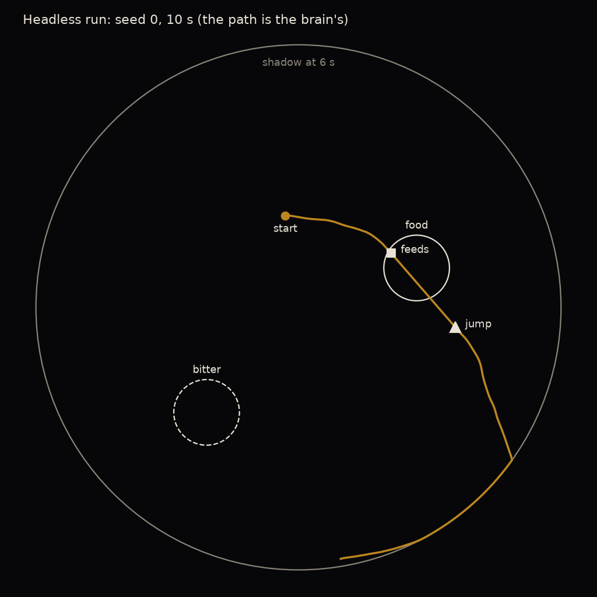

# Chapter 26 — Senses in, movement out

> The brain is real. The eyes, the tongue and the legs are ours. Where exactly does one end and the other begin?

## Where we are
You have a brain, a body and a world, ticking together a thousand times per simulated second. This chapter wires them together, the brain's senses and its motor commands, and is honest about which parts of the fly's behaviour come from 138,639 measured neurons and which from a few constants we chose.

## The idea
FlyWire is a brain without a body. To connect it to a world we need two translations:

- **Senses (world → brain).** A *port* is a group of identified neurons that we force to fire when something happens in the world. Standing on food drives 21 sugar-tasting neurons; a bitter patch drives 42 bitter-tasting neurons; a looming shadow drives looming-detector neurons (LPLC2) on the side it comes from.
- **Movement (brain → body).** A *decoder* reads a few *descending neurons*, the ones that carry commands to the body, and turns their firing rates into speed, turning, an escape jump, or stopping to feed.

Think of a puppet. The puppet's face (the connectome) is carved by nature, every line real. But the strings, where they attach and how hard we pull, are ours. A good puppeteer shows you the strings.

Before choosing, we *measured* ([ADR-0023](../decisions/0023-proposal-sensory-ports.md)): each candidate sense was turned on for one second, and we watched which movement neurons answered. The most surprising answer was silence. With no input at all, this simulated brain does nothing, ever. Real flies wander on their own, but this model has no spontaneous activity. So the fly needs a *walking drive*. We continuously stimulate four central neurons (type CB2777) that feed the P9 walking-command neurons, and we read P9's answer for speed. **The fly walks because we tell it to; how fast is the brain's answer** ([ADR-0036](../decisions/0036-walking-drive-upstream-of-p9.md)).

A first version stimulated P9 itself and read the same neurons back for speed, so "speed" was our own input echoing. A review caught it ([ADR-0035](../decisions/0035-proposal-honest-laplaces-demon.md)), and a test now forbids any neuron from being both stimulated and read.

## Build it
The ports and the decoder live in `tramlines/world/senses.py` and `tramlines/world/decoder.py`. Every constant has a one-line reason ([ADR-0028](../decisions/0028-senses-and-decoder-chosen.md)). Save this as `ch26/where_the_line_falls.py` to lay them out:

```python
"""Chapter 26: the fly's senses and motor decoder, laid out in the open."""

import torch

from tramlines.brain.neurons import load_catalog
from tramlines.world.arena import DEFAULT_ARENA
from tramlines.world.decoder import FlyDecoder
from tramlines.world.fly import FlyState
from tramlines.world.senses import FlySenses

catalog = load_catalog()
senses = FlySenses.from_catalog(catalog)
decoder = FlyDecoder.from_catalog(catalog)

print("SENSES (world -> brain)")
for name in ["sugar", "bitter", "loom_left", "loom_right", "walk_drive"]:
    print(f"  {name:11} {len(getattr(senses, name)):4} neurons")

on_food = FlyState(x_mm=18.0, y_mm=6.0)
nowhere = FlyState(x_mm=0.0, y_mm=0.0)
for label, fly in [("on food", on_food), ("on nothing", nowhere)]:
    rates = senses.rates_hz(fly, DEFAULT_ARENA)
    firing = int((rates > 0).sum())
    print(f"  {label:11} -> {firing} of {len(rates)} input neurons driven")

print("DECODER (brain -> body)")
#            P9 x4        DNa02 L, R  MDN x4      GF L, R   MN9 L, R
walking = [28.0] * 4 + [10.0, 30.0] + [0.0] * 4 + [0, 0] + [0, 0]
feeding = [28.0] * 4 + [10.0, 30.0] + [0.0] * 4 + [0, 0] + [60, 80]
escaping = [28.0] * 4 + [10.0, 30.0] + [0.0] * 4 + [100, 160] + [60, 80]
for label, rates in [("walking", walking), ("feeding", feeding), ("escaping", escaping)]:
    command = decoder.command(torch.tensor(rates, dtype=torch.float64), FlyState())
    print(
        f"  {label:9} speed {command.forward_mm_s:5.1f} mm/s  turn {command.turn_rad_s:+.2f} rad/s"
        f"  jump {command.jump_mm:4.1f} mm  feed {command.feed}"
    )
```

## Run it

```bash
uv run python ch26/where_the_line_falls.py
```

```text
SENSES (world -> brain)
  sugar         21 neurons
  bitter        42 neurons
  loom_left    108 neurons
  loom_right   102 neurons
  walk_drive     4 neurons
  on food     -> 25 of 277 input neurons driven
  on nothing  -> 4 of 277 input neurons driven
DECODER (brain -> body)
  walking   speed  14.0 mm/s  turn -1.57 rad/s  jump  0.0 mm  feed False
  feeding   speed   0.0 mm/s  turn +0.00 rad/s  jump  0.0 mm  feed True
  escaping  speed   0.0 mm/s  turn +0.00 rad/s  jump 15.0 mm  feed False
```

Now the whole fly, for ten simulated seconds (`scripts/run_headless.py`):



## The click
Look at "on nothing → 4 of 277 input neurons driven". Even standing on bare floor, four neurons are being pushed: the walking drive. That one line is the most honest sentence in this book about what the fly is *doing*. And a surprise came with the honest version: driven only from upstream, in a silent world, this brain walks dead straight. The gentle curving walk of the first version was a side effect of stimulating P9 directly.

Now sort what you saw in the picture into two piles.

**From the measured brain:** stepping onto sugar made the feeding motor neuron fire, and the fly stopped to eat. A bitter patch would have suppressed that (we checked: at equal strength, bitter silences it). A shadow on one side made the escape neuron fire hardest on that side, and the fly fled mid-meal. How fast it walks is P9's answer to the drive, so sugar, bitter and shadows can change it.

**From us:** that it walks at all; the size of the speed gain; how far a jump carries it; the thresholds for "eating" and "fleeing"; and the fact that its path crosses the food. That last one is because we chose the starting point: this model has no way to smell or see food.

Neither pile is embarrassing. A simulation that tells you which pile everything belongs in is worth more than one that lets you assume it is all the brain's. The project keeps a [decision history](../decisions/history.md) of every choice, including the ones we changed after watching the fly (feeding used to flicker on and off; the first escape jump was too short to leave the food).

## Break it

1. In `senses.py`, set `WALK_DRIVE_HZ = 0.0` and run `scripts/run_headless.py --seconds 3`. What does the fly do? Then try 100 and 200: how does P9, and so the speed, follow?
2. Set `BITTER_HZ` very high and move the bitter patch onto the food in a copy of the arena. Does the fly still feed?
3. In `decoder.py`, set `MN9_FEED_STOP_HZ` equal to `MN9_FEED_START_HZ`. Run again and count the "starts feeding" lines.
4. Flip the sign of `TURN_RAD_S_PER_HZ`. Which way does the walk curve now, and what does that tell you about how much the "steering" is ours?

## When it goes wrong

- **`ValueError: expected 14 readout neurons`.** The annotation file is not release v2.1.0; names differ between releases. Re-run `scripts/fetch_data.py`.
- **The fly never moves.** The walking drive is off, or the P9 readout gain is 0.
- **The fly jumps constantly.** The jump cooldown is missing, or the Giant Fiber threshold is too low for the window size.

## Check yourself

1. Why does the fly need a walking drive at all, and why is it not P9 itself?
2. Name two behaviours that come from the measured wiring, and two that come from our choices.
3. Why does the decoder look at the fly's current state (`fly.feeding`)?
4. Why can this fly not *approach* food?

??? note "Answers"
    1. The simulated brain has no spontaneous activity: with no input, no neuron ever fires. It is not P9, because P9 is what we read for speed; driving it would make the speed our own input read back.
    2. From the wiring: sugar → feeding, bitter suppressing feeding, looming → escape on the correct side, how fast P9 answers the drive. From us: that it walks, the speed gain, jump distance, thresholds, the starting point.
    3. For hysteresis: it takes more MN9 activity to *start* feeding than to *keep* feeding, which stopped feeding from flickering on and off.
    4. Nothing in the model senses food at a distance (no smell, no vision of food), so food only exists for the fly once it is standing on it.

## Decisions in this chapter

- [ADR-0023: the survey and the options for senses](../decisions/0023-proposal-sensory-ports.md)
- [ADR-0024: the options for the decoder](../decisions/0024-proposal-motor-decoder.md)
- [ADR-0028: what was chosen, and the history of how](../decisions/0028-senses-and-decoder-chosen.md)
- [ADR-0036: the walking drive moved upstream of P9](../decisions/0036-walking-drive-upstream-of-p9.md)
- [ADR-0039: the null brain, the same senses and decoder on scrambled wiring](../decisions/0039-result-2-null-brain.md)
- [Honesty page](../honesty.md)

## Next
The fly lives, deterministically; in Part VI you will put it on a screen, with its ghost walking ahead.
