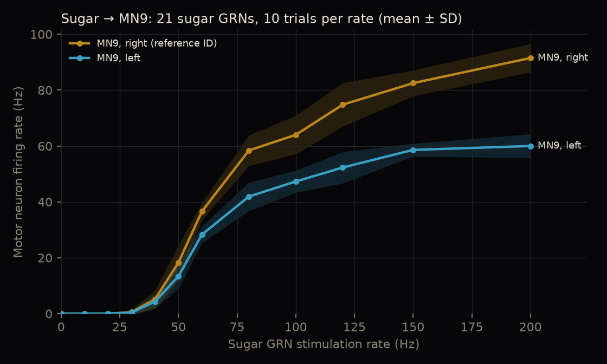

# 0020 — Sugar → MN9: the acceptance result and its regression bands

- Status: Accepted (delegated)
- Date: 2026-10-22
- Phase: 1
- Decider: Claude (delegated)

## Context
CLAUDE.md 7.3 makes sugar → MN9 the Phase 1 acceptance test ("if it fails, nothing after it is trusted") and 13.2 asks for a scientific regression test with tolerance bands recorded in an ADR. Spike-level correctness is already pinned by the Brian2 golden networks ([ADR-0016](0016-verified-neuron-model.md)); this test guards the behaviour of the *whole* brain.

## The result

Stimulating the 21 reference sugar GRNs ([ADR-0017](0017-annotations-and-neuron-sets.md)) for 1 s, 10 seeds per rate, on the full v783 brain:

Data: `docs/assets/sugar_mn9_reference.csv`. Produced by `scripts/sugar_mn9.py`.

**It matches the published qualitative result:** MN9 is silent without sugar, switches on above a threshold rate, rises steeply and saturates. Cross-checks against the reference simulator itself:

| Comparison | MN9 (reference, right) | Partner CB0701 (left) |
|---|---|---|
| Ours, v783, 200 Hz, 10 seeds | 91.5 ± 5.1 Hz | 60.0 ± 4.3 Hz |
| **Brian2 running Shiu's `model.py` on v783, 200 Hz, 6 trials** | **93.7 ± 3.2 Hz** | **62.2 ± 3.6 Hz** |
| Shiu et al.'s own saved results (v630, Brian2, 30 trials, default rate) | 93.3 ± 3.2 Hz | — |
| Ours, v783, 100 Hz | 64.0 ± 6.9 Hz | 47.3 ± 4.0 Hz |
| Shiu et al.'s own saved results (v630, 100 Hz) | 67.0 ± 6.6 Hz | — |
| Ours, v783, 60 Hz | 36.6 ± 3.1 Hz | 28.3 ± 3.0 Hz |
| **Brian2 running Shiu's `model.py` on v783, 60 Hz, 6 trials** | **38.3 ± 4.1 Hz** | **29.5 ± 4.9 Hz** |

Robustness: stimulating all 67 `sugar/water` GRNs on that side gives the same shape, shifted to lower rates and saturating higher (`docs/assets/sugar_mn9_annotated.png`).

## Options considered
1. **Exact golden value for one seed + tolerance bands over five seeds.** The golden catches *any* change in behaviour instantly; the bands say whether a deliberate change still reproduces the science.
2. **Bands only.** Slower to run on every change, and blind to small changes.
3. **Golden only.** Any deliberate change (for example a different summation order for speed) would break it with no way to tell whether the science still holds.

## Decision
Option 1, in `tests/test_sugar_mn9.py`:

- **Every change:** with no input, the brain stays completely silent (no spikes anywhere in 0.2 s). Seed 0 at 200 Hz gives exactly **98** MN9 spikes in 1 s (the same number Chapter 18 of The Book prints).
- **`uv run pytest -m slow`:** mean MN9 rate over seeds 0–4 must lie in these bands:

| Stimulation | Band | Observed (seeds 0–4) | Why this band |
|---|---|---|---|
| 20 Hz | 0 – 1 Hz | 0 | Below threshold MN9 must stay silent. |
| 60 Hz | 25 – 50 Hz | 36.2 | Mid-rise, the most sensitive point of the curve. |
| 200 Hz | 80 – 105 Hz | 91.6 | Brackets both Brian2 runs (93.7 on v783, 93.3 on v630). |

## Consequences
- A legitimate change to summation order or speed will break the golden value; update it only after the bands pass, and say so in the commit.
- The bands are about ±15%, wide enough for trial-to-trial noise over 5 seeds (SD about 5 Hz), narrow enough to catch broken wiring signs, a wrong weight scale or broken delays.

## For learners
A test can check two different things: "did anything change?" (an exact golden number) and "is it still right?" (a range from the science). We use both. The first is a smoke alarm; the second tells you whether there is really a fire. Chapter 18 runs this experiment.
