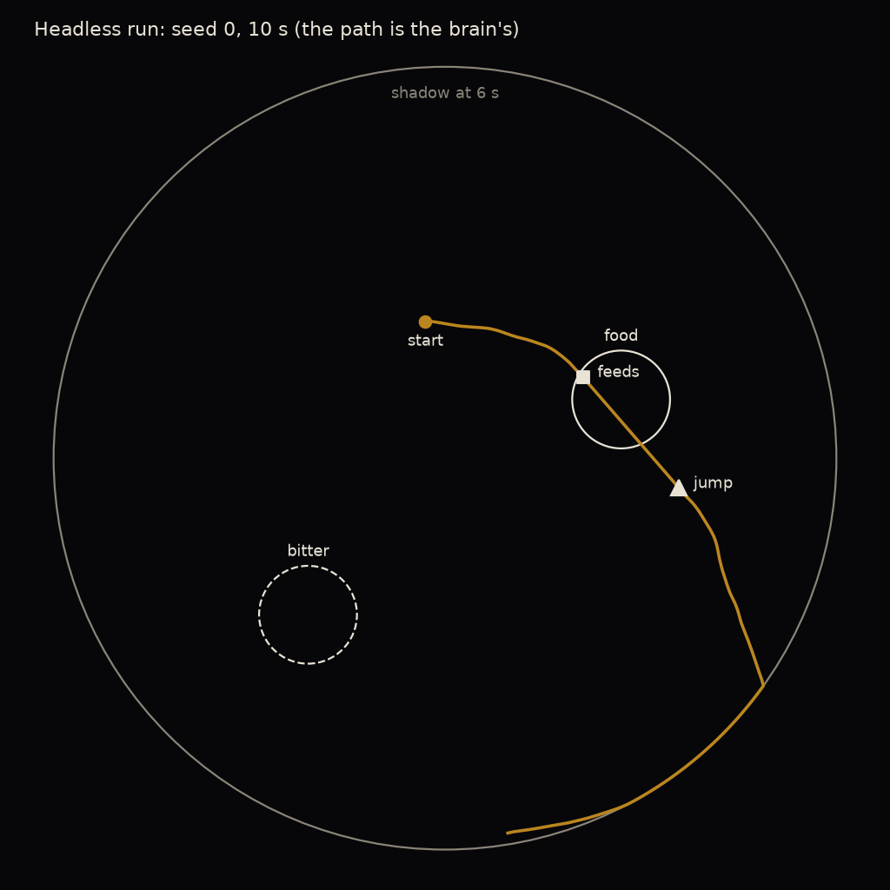

# 0028 — The fly's senses and motor decoder, as chosen

- Status: Accepted (owner delegated: "choose what's best and let's see how it goes", 2026-10-22)
- Date: 2026-10-22
- Phase: 3
- Decider: Claude, on the owner's explicit delegation. Supersedes the proposals [ADR-0023](0023-proposal-sensory-ports.md) and [ADR-0024](0024-proposal-motor-decoder.md), which stay as the record of the options.

## Context
Choosing sensory and motor neurons is Reserved (CLAUDE.md 2.2). The owner delegated this choice, asking that a history of choices be kept ([decision history](history.md)). Evidence: the port survey and the sugar + bitter check (ADR-0023), and the headless runs below.

## Decision: senses (`tramlines/world/senses.py`)

| Port | Neurons (v783, annotations v2.1.0) | Rate | Why this option |
|---|---|---|---|
| Food | the 21 reference sugar GRNs | 150 Hz while on food | Validated in Phase 1; drives MN9 strongly |
| Bitter | all 42 bitter GRNs (`cell_sub_class = bitter`) | 150 Hz while on bitter | Abolishes sugar-driven feeding at equal rates (measured) |
| Looming shadow | LPLC2 on the side the shadow comes from (102 right / 108 left) | 0 → 200 Hz as it grows | Drove the Giant Fiber hardest, on the correct side |
| Wall / touch | none | — | Wind-sensitive JO neurons drove nothing; walls simply stop the fly |
| **Walking drive** | P9 (`hemibrain_type DNp09`, 4 neurons) | **100 Hz, always** | The brain is silent without input, so without a drive the fly never moves |

## Decision: decoder (`tramlines/world/decoder.py`), from rates over a 50 ms window

| Movement | Read from | Rule |
|---|---|---|
| Forward | P9 (mean of 4) minus MDN (mean of 4) | 0.15 mm/s per Hz → about 15 mm/s; limited to −10…30 mm/s |
| Turning | DNa02 left − right | π/40 rad/s per Hz (40 Hz difference → 180°/s), towards the more active side |
| Escape | Giant Fiber, either side | above 50 Hz → a 15 mm hop straight ahead; the body then cannot jump for 500 ms |
| Feeding | MN9 (CB0701), either side | starts above 30 Hz, continues until below 15 Hz; the fly stands still |

Answers to ADR-0024's open questions: **(1)** option 1, the linear decoder; **(2)** BPN is not found, so forward speed uses P9 alone; **(3)** MDN is kept, although it rarely fires; **(4)** the jump goes straight ahead, 15 mm.

## History of how the numbers were reached
Each step below was a headless run, `scripts/run_headless.py`, seed 0, 10 s, default arena:

1. **First run:** start (−6, 14) mm. The fly walked a clockwise loop, crossed the bitter patch, and jumped when the shadow came. But its path missed the food. The fly has no way to sense food at a distance in this model (no smell or sight of food), so it can only find food by walking onto it.
2. **Start moved 4 mm east** to (−2, 14) so the path crosses the food. This is a presentation choice. The fly found the food and fed, but feeding **flickered** on and off about 40 times, as MN9 hovered around the single 30 Hz threshold. The 5 mm escape hop also landed inside the 10 mm-wide food patch.
3. **Feeding hysteresis** (start at 30 Hz, stop below 15 Hz) and a **15 mm hop**. Result below.

Seed 0 events: steps onto food 1.228 s · starts feeding 1.266 s · **shadow arrives, jumps and leaves food 6.105 s**. A second seed is shown in the session journal.

## Consequences
- **Much of the visible behaviour is ours.** Walking exists because we drive P9; its speed is set by our gain; the fly finds food only because the start was chosen so its path crosses it. What the *brain* contributes is real and measured: sugar → MN9 → feeding, bitter suppressing it, looming → Giant Fiber → escape, and the direction it drifts as it walks (DNa02). The honesty page and Chapter 26 say this plainly.
- Driving P9 wakes about 43,000 neurons, so the closed loop runs at **0.12× real time**. This makes the speed question (owner item 4) the main blocker for Phase 4.
- Every number lives in `senses.py` / `decoder.py` with a one-line reason; changing one is a new ADR.
- The sacred tests now include the real fly ("timeline-fly": walks onto food and starts feeding within 150 ms).

## For learners
When you connect a brain to a body, you have to decide where the brain's influence starts and stops. We chose simple, documented rules and tried them, and when the fly behaved strangely (flickering in and out of feeding) we changed a rule and wrote down why. That history is part of the result: it tells you which behaviour comes from the connectome and which from us. Chapter 26 walks through every choice.
