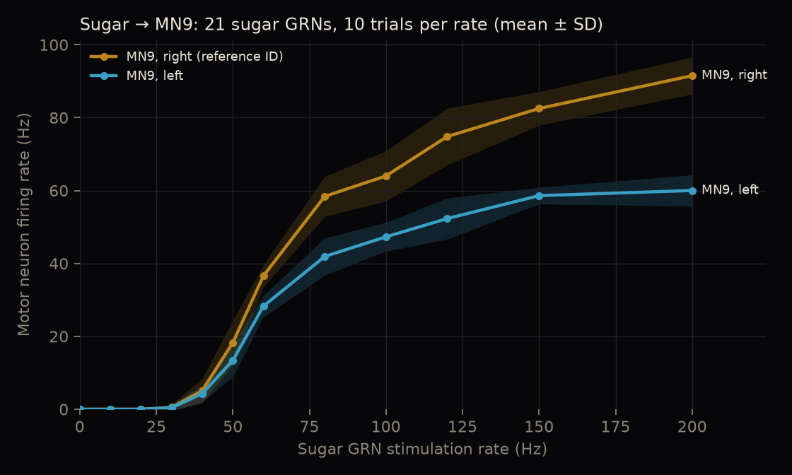
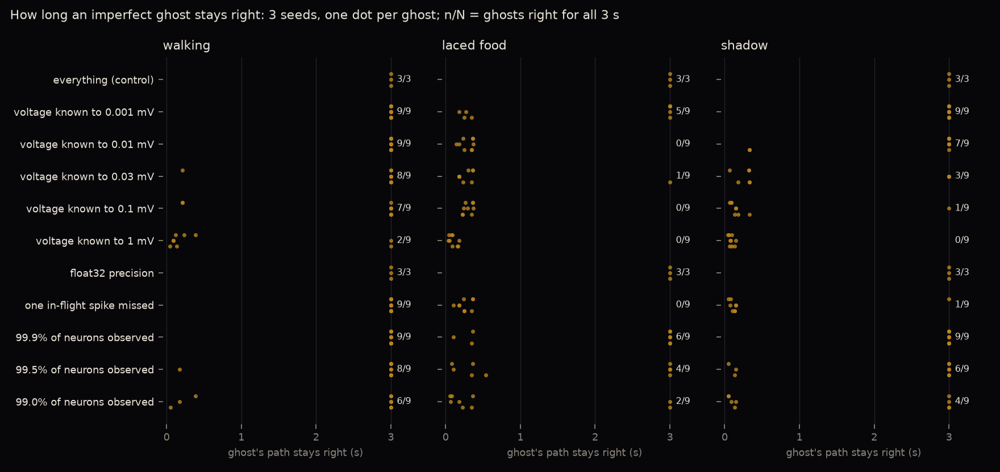
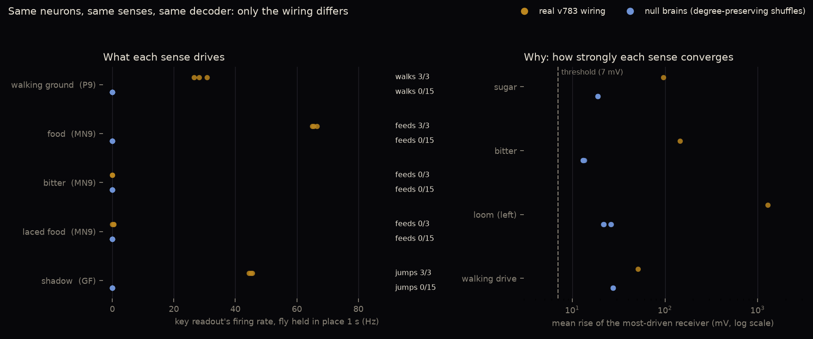
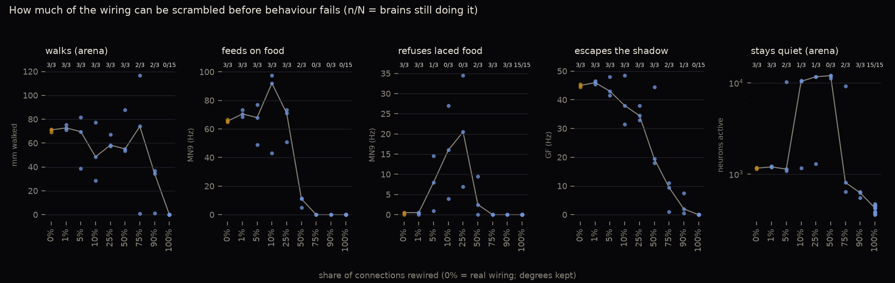
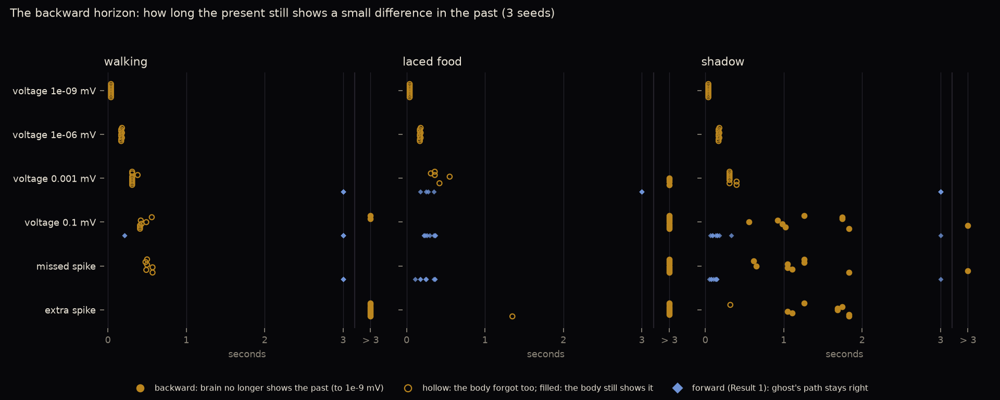
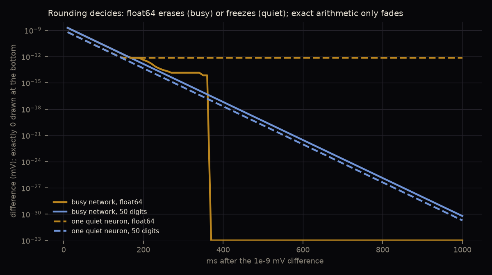

# Tramlines: an honest Laplace's demon for a fly brain

*Write-up draft (skeleton). Working title; the name is owner decision 6.*

!!! warning "Status: draft, not for release"
    - **Every number** carries its source in brackets, such as [ADR-0038]. A number without a source is a mistake in this draft. Nothing here is new: every value is copied from an ADR, a committed plan or a committed data file.
    - **Result 3 is a placeholder.** The perturbation atlas is running; no atlas result is reported here.
    - **Public wording is the owner's** (CLAUDE.md 2.2 and 4). In particular: how novelty is framed (owner decision 28), the free-will wording (decision 26), FlyWire's accuracy (decision 27), and whether to cite Brembs 2011 on the honesty page (decision 29). Passages that depend on an open decision are marked *(decision N)*.
    - Every statement is about **this model**, not about real flies.

## Abstract (draft)

A deterministic simulation can always be predicted by a perfect copy of itself, so a perfect prediction shows only that the copy is exact. We use that perfect copy as a control, and ask instead how much a predictor must know about a simulated brain to foresee it. The model is the whole adult *Drosophila* central brain from the FlyWire v783 connectome (138,639 neurons, 15,091,983 connections) [ADR-0013], simulated with the leaky integrate-and-fire model of Shiu et al. 2024 [ADR-0016] and connected in a closed loop to a simple body in a 2D dish [ADR-0025, ADR-0028, ADR-0036]. We report three results so far, and a fourth is in progress. **(1) Predictability horizon.** A predictor that misses one spike in transit stayed right in 6 of 6 trials while the fly walked, and in 1 of 18 at moments when the fly was deciding [ADR-0038]. A voltage error of 0.001 mV was harmless while walking and under a faint shadow (9/9 each), but failed in 4 of 9 trials at a laced-food decision [ADR-0038]. **(2) The brain's contribution.** On fully rewired (degree-preserving) connectomes, the fly does nothing (0/15 against 3/3), extending Shiu et al.'s shuffled-weight result to behaviour. With up to a quarter of connections rewired, walking, feeding and escape did not fail in any of 9 brains tested, while a two-sense decision (refusing bitter-laced food) held in 1 of 9 [ADR-0039]. **(3) Perturbation atlas.** In progress, pre-registered [atlas plan]. **(4) Backward horizon.** Small differences in the brain's past fade within tens to hundreds of milliseconds. In all 92 pairs whose bodies ended in the same state, the brains could no longer be told apart at 3 s; of 67 pairs whose bodies differed, 43 still could [ADR-0041]. An exact-arithmetic check shows that in the model's equations the difference only shrinks, and that whether it finally vanishes or freezes is decided by the computer's rounding [ADR-0041]. Each result has close neighbours in the literature; what we add is measuring them together, at the level of behaviour, in one untrained whole-brain connectome model in a closed loop *(decision 28)*.

## 1. Introduction

### 1.1 The question

Laplace imagined an intellect that knows the position of everything in the universe and the laws that move it; for such an intellect, the future and the past would be as plain as the present. A simulation run on a computer is a world where that intellect can exist: the program is deterministic, so the same state, with the same random seed, always gives the same future, bit for bit [ADR-0007, ADR-0022].

That makes perfect prediction of a simulation trivial. The interesting question is the demon's own: **how much must you know about a brain to foresee it, and where does that knowledge stop mattering?** [ADR-0035]. We ask it four ways:

1. How precisely must the predictor know the brain's *state*? (Result 1.)
2. Must it know the *wiring*, and how wrong can its map of the wiring be? (Result 2.)
3. Which single *events* can it not afford to miss, where and when? (Result 3.)
4. Can it recover the *past*? (Result 4, added by [ADR-0040].)

### 1.2 The control

Next to the live simulation runs a *ghost*: a copy of the same brain and body, from the same saved state, with the same random numbers. It is always right, and that is what deterministic means; it is a check that nothing has gone wrong, not a feat of prediction [ADR-0035; honesty page]. Its correctness is enforced by tests that compare whole spike rasters and every byte of the final state by SHA-256 [ADR-0022]. Every result below is a departure from this control: a ghost that knows a little less.

### 1.3 What is new, and what is not

*(This section's framing is owner decision 28. Drawn from the [literature notes](../science/literature-notes.md#what-is-new-what-is-not).)*

- **Embodied, closed-loop whole-brain fly models already exist**, including one on the same data release (Rojas Aliaga 2026, preprint), one with a trained controller (Jin et al. 2026, preprint), public code projects, one of them pre-registered, and an announcement by Eon Systems. This work is not the first of its kind and does not claim to be.
- **The dynamics behind Results 1 and 4 are established theory.** Networks of leaky integrate-and-fire neurons can be stable to small perturbations while a single extra or missing spike switches their trajectory, a regime known as stable chaos (Monteforte & Wolf 2012; Jahnke et al. 2008; Zillmer et al. 2006; Politi & Torcini 2009). Fading memory in spiking circuits is the basis of liquid state machines (Maass et al. 2002).
- **The question of Result 3 is London et al.'s** (2010): does one extra spike change a brain's future? The same experiment has been done in a detailed cortical model (Nolte et al. 2019).
- **The full-shuffle part of Result 2 is Shiu et al.'s** (2024): shuffled weights drove MN9 in 1 of 100 simulations.
- **What may be new** is the combination: the demon's four questions asked of one untrained whole-brain connectome model in a closed loop, each answered at the level of the animal's behaviour, with a bit-exact control, pre-registration (Results 3 and 4) and corrections on the record. Taken one at a time, each result has close neighbours.

### 1.4 This draft

Section 2 assembles the methods from the decision records (ADRs). Section 3 reports each result with its existing figure and its intervals. Section 4 states the limits and the prior work. Section 5 says where the data and code are.

## 2. Methods

### 2.1 Data

- **Connectome.** FlyWire v783 public release (Dorkenwald et al. 2024), as the two files used by the reference model (`Completeness_783.csv`, `Connectivity_783.parquet`), downloaded from the Shiu et al. repository at a pinned commit and checked by SHA-256 [ADR-0002, ADR-0013]. Contents: 138,639 neurons; 15,091,983 connections; 54,492,922 synapses; 9,059,302 excitatory and 6,032,681 inhibitory connections [ADR-0013].
- **Annotations.** `flyconnectome/flywire_annotations` tag v2.1.0 (Schlegel et al. 2024), which contains all 138,639 neurons [ADR-0017]. Every neuron used is looked up by cell type from these annotations, never typed in by hand.

### 2.2 Neuron model

The leaky integrate-and-fire model of Shiu et al. 2024, as their reference code runs it in Brian2 [ADR-0003, ADR-0016]:

| Parameter | Value [ADR-0016] |
|---|---|
| Resting and reset potential | −52 mV |
| Threshold (spike if strictly above) | −45 mV |
| Membrane time constant τ_m | 20 ms |
| Synaptic time constant τ_syn | 5 ms |
| Refractory period | 2.2 ms (0 for stimulated input neurons) |
| Synaptic delay | 1.8 ms |
| Weight per synapse w_syn | 0.275 mV |
| Poisson input event | +68.75 mV (w_syn × 250) |
| Time step | 0.1 ms, exact (closed-form) integration |

Connection weight is the signed synapse count: positive for acetylcholine, negative for GABA and glutamate, a sign rule already applied in the released file and used as given ([reference-model notes](../science/reference-model-notes.md)). Spikes arriving at a refractory neuron are discarded, as Brian2 does [ADR-0016].

**Verification.** On two random 400-neuron networks, our engine reproduces Brian2 running the reference code exactly: every one of about 12,300 spikes per network identical in neuron and step, final voltages within 10⁻⁹ mV [ADR-0016]. On the full brain, stimulating the 21 reference sugar neurons at 200 Hz drives MN9 at 91.5 ± 5.1 Hz (10 seeds), against 93.7 ± 3.2 Hz for Brian2 running the reference code on v783 (6 trials) [ADR-0020]. See §3.0.

### 2.3 Engine and determinism

- **Engine.** PyTorch on CPU, float64, deterministic algorithms, one thread, a per-timeline random generator [ADR-0004, ADR-0007]. Spike delivery is event-driven [ADR-0018], and only neurons not at rest are computed, with identical results to the straightforward engine, checked by tests [ADR-0027].
- **State and forks.** A timeline's whole mutable state (voltages, synaptic inputs, refractory bookkeeping, spikes in transit, input rates, the random generator) is 5.83 MB; the wiring (182 MB) is shared between forks, never copied [ADR-0008, ADR-0021].
- **The sacred tests.** "Identical" means equal SHA-256 of the whole spike raster and of every byte of the final state. Three properties are tested: a fork matches the original, a fresh process matches, and a saved and reloaded state continues identically; with negative controls proving the tests can see a difference. The gate repeats every property 100 times per scenario [ADR-0022]; the tests run on every pull request, and the gate weekly, on GitHub [ADR-0045]. Bit-exactness is promised on one machine, not across machines [ADR-0021].

### 2.4 World and body

A round dish (default radius 40 mm) with circular food and bitter patches and looming shadows scheduled in time; a fly with position, heading and feeding state in float64. Every 1 ms of simulated time, the senses set the brain's input rates, the brain runs 10 steps, readout spikes are counted in a sliding 50 ms window, and the decoder turns the window's rates into a movement [ADR-0006, ADR-0025]. The whole timeline (brain, body, decoder window) forks and saves as one [ADR-0025].

### 2.5 Senses, decoder and the decision dish

Every link between brain and world is our design choice, recorded with its history ([decision history](../decisions/history.md)) [ADR-0028, ADR-0036].

| Senses | Neurons | Rate |
|---|---|---|
| Food | the 21 reference sugar GRNs | 150 Hz while on food [ADR-0028] |
| Bitter | all 42 bitter GRNs | 150 Hz while on bitter [ADR-0028] |
| Looming shadow | LPLC2 on the shadow's side (102 right, 108 left) | 0 → 200 Hz as it grows [ADR-0028] |
| Walking drive | the 4 CB2777 neurons, upstream of P9 | 150 Hz, always [ADR-0036] |

| Movement | Read from | Rule |
|---|---|---|
| Forward | P9 minus MDN | 0.5 mm/s per Hz [ADR-0036] |
| Turning | DNa02 left − right | π/40 rad/s per Hz [ADR-0028] |
| Escape | Giant Fiber | above 50 Hz: a 15 mm hop, then 500 ms without jumping [ADR-0028] |
| Feeding | MN9 | starts above 30 Hz, stops below 15 Hz; the fly stands still [ADR-0028] |

- **No neuron is both driven and read**, enforced by a test (`tests/test_senses.py`) [ADR-0036]. Walking itself is our drive; its speed is the brain's answer to it [ADR-0036].
- **The fly cannot find food at a distance** (no smell or sight of food); its start is placed so its straight path crosses the food, a presentation choice [ADR-0028, ADR-0036].
- **The decision dish** places two calibrated close calls on the fly's path: food laced with bitter at strength 0.72 (where about half of seeds feed), reached at about 1.2 s, and a faint shadow at strength 0.055 at 3.0–3.5 s (where about half jump) [ADR-0032, ADR-0036]. Results 1, 3 and 4 use this dish.

### 2.6 Result 1: predictability horizon

- **Imperfect knowledge** (`tramlines/timeline/perturb.py`), applied to the brain only; the body, the dish and the senses' random numbers stay exact [ADR-0037]: every voltage blurred by Gaussian noise of σ = 0.001, 0.01, 0.03, 0.1 or 1 mV; the state stored at float32; one spike in transit missed (refused, not silently skipped, when none is in transit); 99.9%, 99.5% or 99% of neurons observed, the rest assumed at rest [ADR-0038].
- **Design.** 3 seeds × 3 moments (walking at 0.5 s, laced food at 1.2 s, shadow at 3.35 s) × 3 random draws per kind of error (one run for errors without chance); each ghost and the truth run 3 s ahead [ADR-0038].
- **"Right"**: the ghost's path stays within 0.1 mm of the truth's for the whole 3 s [ADR-0037, ADR-0038].
- **Self-check.** Seed 0 with draw 0 repeats the first pass [ADR-0037]; all 27 shared cases came out identical, field for field [ADR-0038].
- Not pre-registered; the second pass was designed after the first [ADR-0038].

### 2.7 Result 2: the brain's contribution

- **The null brain.** Degree-preserving rewiring (Maslov & Sneppen 2002): the receivers of connections are permuted, so every neuron keeps its in- and out-degree, its outgoing weights and its sign; a `fraction` parameter rewires only a share of connections [ADR-0039].
- **Tests of behaviour.** An arena run, and clamped probes: the fly held in place for 1 s on walking ground, food, bitter, laced food and under a full shadow [ADR-0039].
- **A test that does not use our decoder.** Which neurons respond to each sense, how many synapses from the sense they are, and whether the situation can be read from neurons two or more synapses from any input [ADR-0039].
- **Design.** Real wiring × 3 seeds; 5 full null brains × 3 seeds (planned, in [ADR-0035]); then partial rewiring at 1, 5, 10, 25, 50, 75 and 90%, 3 brains each, seed 0 (exploratory) [ADR-0039].
- **What is confirmatory.** Real against full null was planned; the probes, the sweep and the cut-offs were added after seeing data and are exploratory; predictions for the 75%/90% points and the decoder-free test were written before those runs [ADR-0039; [null-brain predictions](../science/null-brain-predictions.md)].

### 2.8 Result 3: perturbation atlas (pre-registered)

The plan was merged before the study ran ([atlas plan](../science/atlas-plan.md)). In brief: 3 seeds × 8 moments on the decision dish; in each, single extra spikes in 2,000 neurons drawn uniformly from all neurons, 300 from neurons not at rest, and all 277 driven input neurons; a 30 ms screen for a cascade (any spike different), then a 3 s follow-up of a sample to see whether the fly's choice (how many times it starts feeding, how many times it jumps) changes; and a decoder-robustness check with a 100 ms window and thresholds ×1.2 and ×0.8 [atlas plan]. Five hypotheses with stated criteria (H1–H5) [atlas plan].

### 2.9 Result 4: backward horizon (pre-registered)

The plan was merged before the study's code ran on any data ([backward-horizon plan](../science/backward-horizon-plan.md)) [ADR-0041].

- **Pairs.** From one saved state, a truth and an altered timeline that differs by one small change, run 3 s with the same inputs. Changes: voltage noise of 10⁻⁹, 10⁻⁶, 10⁻³ or 10⁻¹ mV; one missed spike in transit; one extra spike in a walking-drive neuron. 3 seeds × 3 moments × 18 changes: 162 pairs, 159 made (3 had no spike in transit to miss) [ADR-0041].
- **B_brain(ε)**: the earliest time from which the two brains stay indistinguishable at precision ε (same spikes in transit, same refractory neurons, same random stream, and voltages and inputs within ε), sampled every 10 ms; censored if never within 3 s [backward-horizon plan].
- **Exact-arithmetic check.** A scalar re-implementation of the engine, first checked against it bit for bit, run on a 400-neuron network in float64 and in 50-digit decimal arithmetic [ADR-0041].
- **Deviations** from the plan are listed in [ADR-0041]: Python's `decimal` instead of mpmath; one pair group rerun after a bug fix (an "extra" spike in a neuron that had already fired); an exploratory quiet-neuron demonstration.

### 2.10 Statistics

Proportions are given as counts with Wilson 95% intervals; medians with bootstrap 95% intervals (10,000 resamples) [ADR-0041; backward-horizon plan]. Intervals for Results 1 and 2 were added afterwards by `scripts/analyse_uncertainty.py` (data `docs/assets/uncertainty_results_1_2.csv`); ghosts share seeds within a moment, so those intervals may be slightly too narrow [ADR-0038]. No p-values; each pre-registered hypothesis is judged by its stated criterion [backward-horizon plan]. Small samples throughout: read 2/3 as "most", not as 67% [ADR-0039].

### 2.11 The viewer

Not a result, but how the results are shown. The timeline is computed a few seconds ahead of the screen and played at real speed [ADR-0030, ADR-0033]. A "how much does the ghost know?" slider replaces the control with one draw of one of Result 1's imperfect ghosts, beside Result 1's counts for that setting [ADR-0042]. A FREE WILL button, offered while a taste or a shadow is active, forks the moment into 8 futures, each with one extra spike in a different driven input neuron, named on screen, and measures how they diverge [ADR-0031, ADR-0046]. *(Public wording of the fan: decision 26.)*

## 3. Results

### 3.0 Model check: sugar drives the feeding motor neuron

Stimulating the 21 reference sugar neurons for 1 s (10 seeds per rate) reproduces Shiu et al.'s qualitative result: MN9 is silent without sugar, switches on above a threshold rate, rises steeply and saturates [ADR-0020]. At 200 Hz, 91.5 ± 5.1 Hz against Brian2's 93.7 ± 3.2 Hz on the same data; at 100 Hz, 64.0 ± 6.9 Hz against Shiu et al.'s saved 67.0 ± 6.6 Hz (v630) [ADR-0020]. Regression bands guard this on every change [ADR-0020].

### 3.1 Result 1: what the ghost must know depends on when it looks

Ghosts right for all 3 s (paths within 0.1 mm), 3 seeds [ADR-0038]:

| The ghost knows… | walking | laced food | shadow |
|---|---|---|---|
| everything (control) | 3/3 | 3/3 | 3/3 |
| float32 precision | 3/3 | 3/3 | 3/3 |
| voltage to 0.001 mV | 9/9 | 5/9 | 9/9 |
| voltage to 0.01 mV | 9/9 | 0/9 | 7/9 |
| voltage to 0.03 mV | 8/9 | 1/9 | 3/9 |
| voltage to 0.1 mV | 7/9 | 0/9 | 1/9 |
| voltage to 1 mV | 2/9 | 0/9 | 0/9 |
| one in-flight spike missed | 6/6 | 0/9 | 1/9 |
| 99.9% of neurons | 9/9 | 6/9 | 9/9 |
| 99.5% of neurons | 8/9 | 4/9 | 6/9 |
| 99.0% of neurons | 6/9 | 2/9 | 4/9 |

Key contrasts, with Wilson 95% intervals [ADR-0038, uncertainty table]:

| Claim | Counts | 95% interval |
|---|---|---|
| Missed spike harmless while walking | 6/6 | 61–100% |
| Missed spike at decisions (laced food + shadow) stays right | 1/18 | 1–26% |
| Difference, walking − decisions | +94 points | +50 to +99 |
| 0.001 mV at the laced food stays right | 5/9 | 27–81% (elsewhere 9/9, 70–100%) |
| 0.01 mV: walking against laced food | 9/9 vs 0/9 | difference +100 points, +58 to +100 |
| float32 stays right, all moments | 9/9 | 70–100% |
| Time to fail, all 118 failed ghosts | median 177 ms | 148–211 ms |

1. **One missed spike is harmless while walking and decisive at a decision** (6/6 against 1/18) [ADR-0038].
2. **At the laced food, no voltage precision tested was good enough:** 0.001 mV failed in 4 of 9 ghosts, 0.01 mV in all 9 [ADR-0038]. The first pass, on one seed, had found 0.001 mV harmless; a second seed showed it was not [ADR-0037, ADR-0038].
3. **Float32 was always enough** (9/9); its error is about 10⁻⁶ mV at these voltages [ADR-0038].
4. **Timing matters more than precision.** Ghosts started while walking pass through the same laced food and shadow and stay right (0.01 mV: 9/9; missed spike: 6/6); the same errors made at the decision almost always fail [ADR-0038].
5. *Withdrawn:* the claim that seeing 99.9% of neurons is not enough at the laced food (6/9 against 9/9 elsewhere; difference +33 points, interval −3 to +65) [ADR-0038].

These match the stable-chaos picture for LIF networks: small continuous errors shrink, while a spike-sized difference can switch the trajectory (Monteforte & Wolf 2012). Stability was not measured as Lyapunov exponents [ADR-0037].

### 3.2 Result 2: the behaviour lives in the wiring

1. **Full null brains do nothing the body can see.** Real wiring walks about 70 mm, feeds about 5 s and escapes the shadow in 3/3 seeds; null brains never move (0/15) [ADR-0039]. Every behaviour: 3/3 (44–100%) against 0/15 (0–20%) [ADR-0039, uncertainty]. This extends Shiu et al.'s shuffled-weight result (1 of 100) to a different null and to behaviour [ADR-0039].
2. **Why: convergence.** The 21 sugar neurons' connections land on 289 neurons in the real brain and about 1,520 in a null one; the strongest real receiver of each sense gets a mean rise of 51–1,289 mV against 13–28 mV in null brains [ADR-0039].
3. **Without our decoder.** Null brains are not empty: the situation can be read from their deep neurons in 58 of 60 tests (89–99%; chance 25%) [ADR-0039]. But food-responsive activity two or more synapses from the sense reaches 216 neurons in the real brain and 0–22 in full null brains [ADR-0039].

4. **Partial rewiring (exploratory; 3 brains per share, seed 0).** Walking, feeding and escape did not fail in any of the 9 brains rewired by 5–25% (27/27; 88–100%), which still allows a true failure rate of up to 56% at any one share [ADR-0039]. Refusing laced food held in 1 of 9 (2–43%); the break is demonstrated from 10% (0/3), not at 5% alone [ADR-0039]. Pooling 5–25% is a grouping chosen after seeing the data [ADR-0039].
5. **Runaway activity.** Between 5% and 50% rewired, many brains tip into about 10,000 active neurons instead of about 1,200, often triggered by the shadow [ADR-0039].
6. **Predictions written beforehand** for the 75%/90% points and the decoder-free test: 9 of 10 sweep predictions held [ADR-0039].

The shape of the curve between shares cannot be settled with 3 brains per share; that claim was withdrawn [ADR-0039].

### 3.3 Result 3: perturbation atlas — placeholder

!!! note "Placeholder: no result yet"
    The study is running under the [pre-registered plan](../science/atlas-plan.md). This section will report E1–E4 and H1–H5 exactly as the plan defines them, with every deviation listed in the results ADR. Do not fill it from the pilot.

    For orientation only, the plan records what the pilot (seed 0, different moments, already seen when the plan was written) found: 4–10% of random single spikes cascaded within 30 ms (48–64% in driven input neurons); about half of followed cascades changed the path; 1 of 120 screened-out spikes still changed behaviour later [atlas plan]. These shaped the design and are not a result.

    Planned figure: `docs/assets/atlas.png`. Planned comparison with London et al. 2010 is not in the plan and would be exploratory ([literature notes](../science/literature-notes.md)).

### 3.4 Result 4: the brain forgets, the body remembers

| Pre-registered hypothesis | Result | Verdict [ADR-0041] |
|---|---|---|
| H1, the rounding floor | 108/108 [97–100%]; 77/81 [88–98%] | Supported |
| H2, the brain forgets spikes | 18/36 [34–66%] | Supported, exactly at the threshold: read as "about half" |
| H3, the body remembers | 34/36 [82–98%]; 4/81 [2–12%] | Supported |
| H4, the body keeps the brain apart | 43/67 [52–75%] vs 0/92 [0–4%] | Supported |
| H5, the floor is the computer's | float64 reached exactly 0; 50 digits 6 × 10⁻³¹ mV | Not supported as written |

1. **The brain forgets fast.** Median B_brain(10⁻⁹) is 40 ms for 10⁻⁹ mV differences, 170 ms for 10⁻⁶ mV and 310–360 ms for 10⁻³ mV, at every moment (at the laced food, 4 of 9 of the 10⁻³ mV pairs never forgot) [ADR-0041]: about 140 ms more per thousandfold difference, which is what the 20 ms membrane leak predicts (20 ms × ln 1000 ≈ 138 ms). This is a consistency check on the simulation, not a finding [ADR-0041].
2. **The body remembers.** 34 of 36 spike differences at decisions left the flies in different places or states [ADR-0041].
3. **The body can keep the brain apart.** All 92 pairs whose bodies ended the same had brains indistinguishable by 3 s; 43 of 67 pairs whose bodies differed still had distinguishable brains [ADR-0041].
4. **Rounding decides what "forgotten" means.**

In 50-digit arithmetic, the difference between two pasts only shrinks (to 6 × 10⁻³¹ mV in 1 s). In float64 it was erased outright on the busy test network (exactly zero at 370 ms), and frozen at 7.1 × 10⁻¹³ mV for a quiet neuron (exploratory); in the full brain, differences freeze at about 10⁻¹² mV [ADR-0041]. The hypothesis expected only freezing, so it is not supported as written; what it was testing stands: in the model the past only fades, and the computer's rounding decides whether it is erased or kept [ADR-0041].

*Exploratory.* Under the shadow, 26 of 27 altered flies (spike and 0.1 mV pairs) ended up in a different place, yet their brains forgot within 0.5–2 s, most likely because both flies then sense the same thing (not checked pair by pair) [ADR-0041].

## 4. Discussion

### 4.1 Summary

*(To be written once Result 3 is in.)* A possible thread, from the results above: in this model, the brain is forgiving of small errors except at the moments where the body is deciding [ADR-0038]. At the laced-food decision the future was hardest to predict and the past was kept longest; under the shadow the future was also hard to predict, but the brain forgot the past (exploratory) [ADR-0041]. Many brain futures share one behaviour [ADR-0035; Result 3 will test it, H4].

### 4.2 Limits

From the [honesty page](../honesty.md) and the ADRs' own limits:

- **It is not the fly.** Every neuron follows the same simple equations with the same numbers. There are no neuromodulators, gap junctions, learning, glia or hormones. Connection strength is estimated from synapse counts; whether a connection excites or inhibits is predicted from images [honesty page].
- **The body is ours.** FlyWire is a brain only. The dish, the body, which neurons are senses, the walking drive and the decoder are our design choices [honesty page; ADR-0028, ADR-0036]. Our decoder reads five groups of neurons, far fewer than the real descending repertoire (Cande et al. 2018).
- **No spontaneous activity.** The model is silent without input (Shiu et al. 2024), while real flies act spontaneously (Brembs 2011) *(citing Brembs on the honesty page is decision 29)*.
- **Determinism belongs to the simulation.** It is not a claim about real flies, and not evidence for or against free will. "Free will" is the name of a button; the extra spike is our intervention [honesty page] *(decision 26)*.
- **Small samples.** 3 seeds, 3 moments, 3 draws (Result 1); 3 brains per share, one seed (Result 2's sweep); 3 s horizons [ADR-0038, ADR-0039, ADR-0041].
- **The yardstick.** Readouts and decoder were calibrated on the real brain; the decoder-free test reduces this concern but does not remove it [ADR-0039].
- **Partial observation** assumes unseen neurons are at rest; a ghost that infers them could do better (cf. Beiran & Litwin-Kumar 2025) [ADR-0037].
- **One kind of null** (degree-preserving); a null that also keeps each neuron's input balance may differ [ADR-0039].
- **Not yet tested:** robustness to the model's assumptions in Shiu et al.'s own terms (w_syn ±30%; glutamate as excitatory), which their results suggest could change the laced-food decision ([literature notes](../science/literature-notes.md)).
- **Data accuracy.** Our two data files disagree on the sign of 4.4% of neurons, cause unknown *(public wording: decision 27)*.

### 4.3 Prior work

From the [literature notes](../science/literature-notes.md); the check was not a systematic review.

- **Single spikes.** London et al. 2010 (rat cortex: about 28 extra spikes in direct targets per extra spike, calculated); Nolte et al. 2019 (one extra spike diverges in a deterministic cortical model); Houweling & Brecht 2008 (a train of spikes in one cortical neuron changes a rat's report in 5% of trials); von Reyn et al. 2014 (in real flies, Giant Fiber spike timing selects the escape type).
- **Stability and chaos.** van Vreeswijk & Sompolinsky 1996, 1998 (balanced networks are chaotic); Monteforte & Wolf 2012, Jahnke et al. 2008, Zillmer et al. 2006, Politi & Torcini 2009 (LIF networks can be stable yet switch after a spike); Lajoie et al. 2013 (reliability varies in time). Our model is not in a balanced state: it is silent without input and runs about 1,200 active neurons on the dish [ADR-0039].
- **Predictability.** Boffetta et al. 2002 and Aurell et al. 1997 (predictability time as a function of initial error and tolerance; the framework Result 1 should use); Beiran & Litwin-Kumar 2025 (connectome-constrained prediction from partial recordings).
- **Wiring.** Shiu et al. 2024 (shuffled weights); Maslov & Sneppen 2002 (the null); Lin et al. 2024 (this connectome's structure against degree-preserving nulls); Lappalainen et al. 2024 (connectivity predicts fly visual activity); Randi et al. 2023 (in the worm, anatomy misses neuropeptide signalling); Yad & Nabila 2026, preprint (reconstruction differences break trained circuit models).
- **Bodies.** Rojas Aliaga 2026, preprint; Jin et al. 2026, preprint; NeuroMechFly (Lobato-Rios et al. 2022; Wang-Chen et al. 2024); Vaxenburg et al. 2025; worm models (Izquierdo & Beer 2013; Zhao et al. 2024).
- **Memory and irreversibility.** Maass et al. 2002; Ganguli et al. 2008; Landauer 1961 and Bennett 1973 (erasure is many-to-one; our link to them is only through the computer's rounding, and we measure no heat); Boghosian et al. 2019 (floating point changes a chaotic map's statistics); Clark & Chalmers 1998 (the extended mind; "the body remembers" is a loose physical analogy).

### 4.4 What would strengthen this

From the [overview](../overview.md) and the [literature notes](../science/literature-notes.md): Result 3; Shiu et al.'s robustness checks on our headline results; a direct comparison with London et al.'s measure (exploratory); a Lyapunov measurement if the word "stable" is to be used formally; a null that keeps input balance; and a proposed fifth result on realistic connectome errors (ADR-0047, awaiting the owner, decision 22).

## 5. Data and code availability

- **Code**: the Tramlines repository, MIT licence; documentation, figures and result data CC BY 4.0 [ADR-0043]. The repository is private until the owner releases it (Phase 8); a link goes here then.
- **Data**: FlyWire v783 (CC BY 4.0) is not redistributed; `scripts/fetch_data.py` downloads it from a pinned commit and checks SHA-256 [ADR-0013]. Annotations v2.1.0, also fetched and checked [ADR-0017].
- **Environment**: Python 3.12 with uv; dependencies locked in `uv.lock` [ADR-0004, ADR-0012].
- **Per result**, scripts and committed data:

| Result | Scripts | Data in `docs/assets/` |
|---|---|---|
| Model check | `scripts/sugar_mn9.py` | `sugar_mn9_reference.csv` |
| 1 | `scripts/horizon_study.py`, `scripts/plot_horizon.py` | `horizon.csv`, `horizon_v2.csv` |
| 2 | `scripts/null_brain_study.py`, `scripts/decoder_free_study.py`, `scripts/plot_null_brain.py` | `null_brain*.csv`, `decoder_free.csv` |
| 1, 2 intervals | `scripts/analyse_uncertainty.py` | `uncertainty_results_1_2.csv` |
| 3 | `scripts/atlas_pilot.py`; study script to come | `atlas_pilot.csv`; planned `atlas_*.csv` |
| 4 | `scripts/backward_horizon_study.py`, `scripts/exact_check.py`, `scripts/analyse_backward_horizon.py` | `backward_horizon.csv`, `backward_horizon_summary.csv`, `exact_check.csv` |

- **Decisions**: every design choice, with its reasons and alternatives, is an ADR in `docs/decisions/`; corrections are dated in place.

## Credits

The connectome is the work of the FlyWire consortium (Dorkenwald et al. 2024; Schlegel et al. 2024). The neuron model is Shiu et al. 2024's. Full list and verification status: [citations](../science/citations.md).

## References (to be completed)

Verified against Crossref, DataCite or arXiv; see [citations](../science/citations.md) for the full list and the [literature notes](../science/literature-notes.md) for how much of each was read.

- Dorkenwald, S. et al. Neuronal wiring diagram of an adult brain. *Nature* 634, 124–138 (2024). [doi:10.1038/s41586-024-07558-y](https://doi.org/10.1038/s41586-024-07558-y)
- Schlegel, P. et al. Whole-brain annotation and multi-connectome cell typing of *Drosophila*. *Nature* 634, 139–152 (2024). [doi:10.1038/s41586-024-07686-5](https://doi.org/10.1038/s41586-024-07686-5)
- Shiu, P. K. et al. A *Drosophila* computational brain model reveals sensorimotor processing. *Nature* 634, 210–219 (2024). [doi:10.1038/s41586-024-07763-9](https://doi.org/10.1038/s41586-024-07763-9)
- Stimberg, M., Brette, R. & Goodman, D. F. M. Brian 2, an intuitive and efficient neural simulator. *eLife* 8, e47314 (2019). [doi:10.7554/eLife.47314](https://doi.org/10.7554/eLife.47314)
- London, M. et al. Sensitivity to perturbations in vivo implies high noise and suggests rate coding in cortex. *Nature* 466, 123–127 (2010). [doi:10.1038/nature09086](https://doi.org/10.1038/nature09086)
- Monteforte, M. & Wolf, F. Dynamic flux tubes form reservoirs of stability in neuronal circuits. *Phys. Rev. X* 2, 041007 (2012). [doi:10.1103/PhysRevX.2.041007](https://doi.org/10.1103/PhysRevX.2.041007)
- van Vreeswijk, C. & Sompolinsky, H. Chaos in neuronal networks with balanced excitatory and inhibitory activity. *Science* 274, 1724–1726 (1996). [doi:10.1126/science.274.5293.1724](https://doi.org/10.1126/science.274.5293.1724)
- Maslov, S. & Sneppen, K. Specificity and stability in topology of protein networks. *Science* 296, 910–913 (2002). [doi:10.1126/science.1065103](https://doi.org/10.1126/science.1065103)
- Maass, W., Natschläger, T. & Markram, H. Real-time computing without stable states. *Neural Comput.* 14, 2531–2560 (2002). [doi:10.1162/089976602760407955](https://doi.org/10.1162/089976602760407955)
- Rojas Aliaga, E. M. Emergent individuality and neural integration in whole-brain connectome simulations of *Drosophila melanogaster*. Preprint, Zenodo (2026). [doi:10.5281/zenodo.19152238](https://doi.org/10.5281/zenodo.19152238)
- *Remaining entries: every work named in §1.3 and §4, from [citations](../science/citations.md).*

## Appendix: corrections on the record

Changes to earlier claims, each dated in its ADR:

- ADR-0037 finding 1 (small voltage errors always harmless) did not hold at the laced food [ADR-0038].
- ADR-0037 and ADR-0038: the missed-spike result while walking on seed 0 was void (no spike was in transit); the instrument now refuses instead of silently copying [ADR-0038].
- ADR-0038 finding 5 withdrawn [ADR-0038].
- ADR-0039 finding 4 narrowed: "no failures in 9 brains" rather than "survives a quarter"; the bitter-veto break demonstrated from 10%; no claim about the curve's shape [ADR-0039].
- ADR-0036: re-convergence under the shadow was measured on spikes only, not the full state [ADR-0036].
- ADR-0041: an "extra" spike in a neuron that had already fired changed nothing; the engine now refuses it, and the affected pairs were rerun (no verdict changed) [ADR-0041].
- ADR-0028's walking drive read back as speed; replaced by a drive upstream of P9 [ADR-0035, ADR-0036].

[ADR-0002]: ../decisions/0002-dataset-flywire-v783.md
[ADR-0003]: ../decisions/0003-neuron-model-shiu-lif.md
[ADR-0004]: ../decisions/0004-python-and-pytorch.md
[ADR-0006]: ../decisions/0006-2d-arena-no-physics-body.md
[ADR-0007]: ../decisions/0007-determinism-first.md
[ADR-0008]: ../decisions/0008-fork-shares-weights.md
[ADR-0012]: ../decisions/0012-development-tooling.md
[ADR-0013]: ../decisions/0013-data-files-and-source.md
[ADR-0016]: ../decisions/0016-verified-neuron-model.md
[ADR-0017]: ../decisions/0017-annotations-and-neuron-sets.md
[ADR-0018]: ../decisions/0018-event-driven-engine.md
[ADR-0020]: ../decisions/0020-sugar-mn9-regression-bands.md
[ADR-0021]: ../decisions/0021-brain-state-fork-save.md
[ADR-0022]: ../decisions/0022-determinism-test-protocol.md
[ADR-0025]: ../decisions/0025-world-and-timeline.md
[ADR-0027]: ../decisions/0027-awake-set-engine.md
[ADR-0028]: ../decisions/0028-senses-and-decoder-chosen.md
[ADR-0030]: ../decisions/0030-projection-not-live.md
[ADR-0031]: ../decisions/0031-proposal-aimed-free-will.md
[ADR-0032]: ../decisions/0032-decision-points.md
[ADR-0033]: ../decisions/0033-phase-4-architecture.md
[ADR-0035]: ../decisions/0035-proposal-honest-laplaces-demon.md
[ADR-0036]: ../decisions/0036-walking-drive-upstream-of-p9.md
[ADR-0037]: ../decisions/0037-result-1-predictability-horizon.md
[ADR-0038]: ../decisions/0038-result-1-second-pass.md
[ADR-0039]: ../decisions/0039-result-2-null-brain.md
[ADR-0040]: ../decisions/0040-proposal-backward-horizon.md
[ADR-0041]: ../decisions/0041-result-4-backward-horizon.md
[ADR-0042]: ../decisions/0042-knowledge-slider.md
[ADR-0043]: ../decisions/0043-licence.md
[ADR-0045]: ../decisions/0045-automated-checks.md
[ADR-0046]: ../decisions/0046-free-will-fan.md
[atlas plan]: ../science/atlas-plan.md
[backward-horizon plan]: ../science/backward-horizon-plan.md
